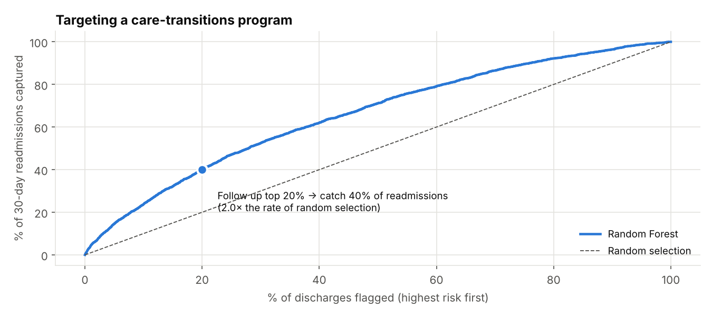
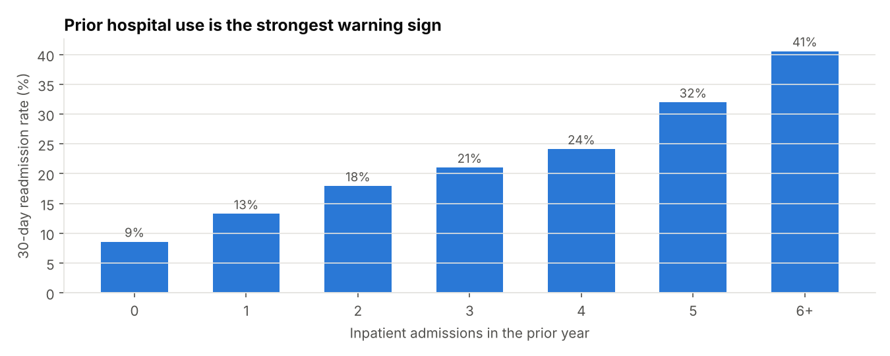
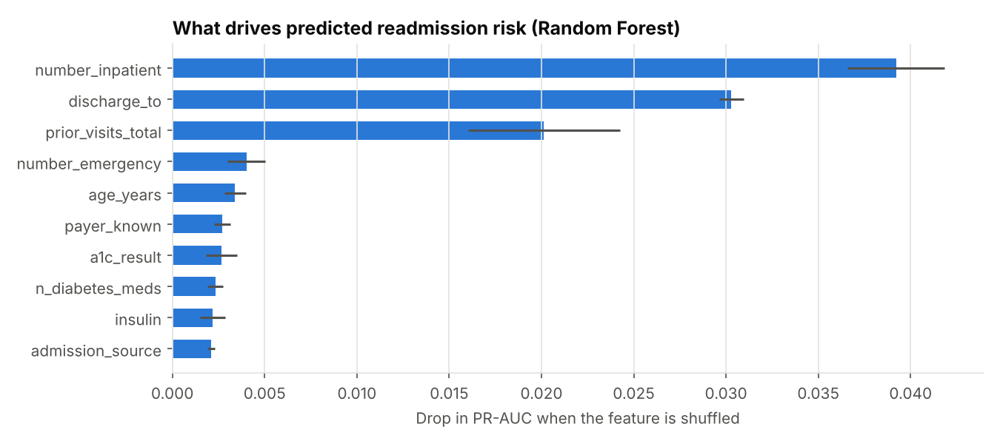
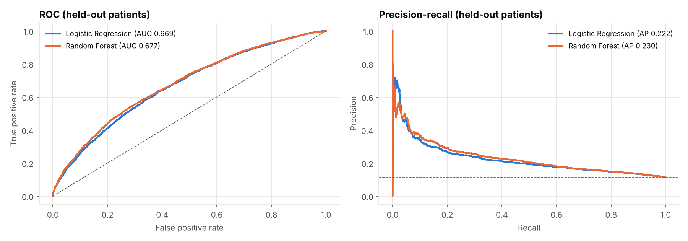

# Patient Readmission Prediction & Healthcare Analytics

Predicts which diabetic patients will be **readmitted within 30 days** of discharge, the measure US hospitals are financially penalised on under Medicare's Hospital Readmissions Reduction Program, and turns the model into a targeting tool for a follow-up care program.

**Data:** 101,766 real hospital encounters from 130 US hospitals, 1999–2008 (UCI *Diabetes 130-US Hospitals*). After cleaning: 99,340 encounters, 69,987 patients, 11.4% readmitted within 30 days.

## Results

| Model | CV ROC-AUC (5-fold, by patient) | Test ROC-AUC | Test PR-AUC | Readmissions caught in top 20% |
|---|---|---|---|---|
| Logistic Regression | 0.661 ± 0.005 | 0.669 | 0.222 | 37.9% |
| **Random Forest** | **0.670 ± 0.005** | **0.677** | **0.230** | **40.1%** |
| No-skill baseline | 0.500 | 0.500 | 0.114 | 20.0% |

**Main result:** if a care-transitions team can follow up only **1 in 5 discharges**, the model's top-20% list contains **40% of all 30-day readmissions**, twice what random selection finds. Among flagged patients, **23%** are readmitted, against an 11% base rate.



**On the ROC-AUC of 0.68:** 30-day readmission is a famously hard target. It depends on things that never appear in a discharge record: whether the patient fills prescriptions, has transport, or has support at home. Published models on this dataset typically land around 0.64–0.70, so the honest framing is "useful for prioritising follow-up," not "predicts who will come back."

## What drives readmission



- **Prior hospital use dominates.** The readmission rate climbs from **9%** for patients with no inpatient stay in the prior year to **41%** for those with 6 or more.
- **Where patients go after discharge matters.** Patients discharged to a rehab facility are readmitted at **27.7%**, against **9.3%** for those discharged home.
- **Unmeasured HbA1c carries more risk.** Encounters where HbA1c wasn't tested have higher readmission (11.7%) than those where it was (about 10%). This is consistent with the original study's finding that testing HbA1c is associated with better follow-through.
- Risk rises gently with age: 10.1% for ages 40–59, 12.5% for 80+.



## Method

**Cleaning** ([`src/features.py`](src/features.py)):
- Removed 2,426 encounters that ended in death or hospice. Those patients cannot be readmitted, and keeping them would teach the model that the sickest patients rarely return.
- `?` is treated as missing. `weight` (97% missing) is dropped. For `payer_code` and `medical_specialty`, missing is kept as its own category, because missingness can carry information.
- ICD-9 diagnosis codes are grouped into 9 clinical categories (circulatory, respiratory, diabetes, and so on).

**Feature engineering:** age-bracket midpoints, total prior visits, number of diabetes medications, number of medication dose changes, grouped admission/discharge types, and the top-10 specialties.

**Evaluation that doesn't leak:** many patients have several encounters. Splitting by *encounter* puts the same person in both train and test and inflates scores, so this project splits by **patient** (`GroupShuffleSplit` and `GroupKFold`), with an assertion that no patient crosses the split. Metrics suit an 11% positive rate: ROC-AUC, PR-AUC and capture rate, not accuracy. Predicting "no readmission" for everyone would be 89% accurate and useless.



## Tableau dashboard

`python src/train.py` writes extracts to [`tableau/`](tableau/):

- `scored_test_encounters.csv`: each held-out encounter with its risk score and risk tier (Low / Medium / High)
- `rate_by_*.csv`: readmission rates by diagnosis group, discharge destination, admission type, HbA1c result, prior inpatient visits and age band

To build it in **Tableau Public**:
1. **Readmission drivers page:** a bar chart for each `rate_by_*` file (value on Rows, `readmit_rate` on Columns, formatted as %), with `encounters` as a tooltip.
2. **Risk-tier page:** from `scored_test_encounters.csv`, put `risk_tier` on Columns and AVG(`readmit_30`) on Rows. That shows the observed readmission rate per tier. Add filters for `primary_dx` and `discharge_to`.
3. **Patient list:** a table of High-tier encounters sorted by `risk_score`, the worklist a care coordinator would use.
4. Publish and add the link here.

## Run it

```bash
pip install -r requirements.txt
python src/train.py      # trains, evaluates, writes results/, images/, tableau/ (~2 min)
pytest                   # 4 tests: ICD-9 grouping, cleaning rules, completeness, no leakage
```

## Data source

Strack B, et al. *Impact of HbA1c Measurement on Hospital Readmission Rates: Analysis of 70,000 Clinical Database Patient Records.* BioMed Research International, 2014. Dataset: [UCI Machine Learning Repository #296](https://archive.ics.uci.edu/dataset/296) (CC BY 4.0). Copy obtained via [swengzju/Predicting-Diabetes-Patient-Readmission](https://github.com/swengzju/Predicting-Diabetes-Patient-Readmission) and checked against the UCI shape (101,766 × 50).

## Project structure

```
├── data/                 diabetic_data.csv.gz, IDs_mapping.csv
├── src/
│   ├── features.py       cleaning, ICD-9 grouping, feature engineering
│   └── train.py          patient-level split, CV, evaluation, charts, Tableau extracts
├── results/              model_comparison.csv, metrics.json, feature_importance.csv
├── tableau/              extracts for the dashboard
├── images/
└── tests/
```

## Tools

Python · pandas · scikit-learn · Matplotlib · Tableau · pytest
